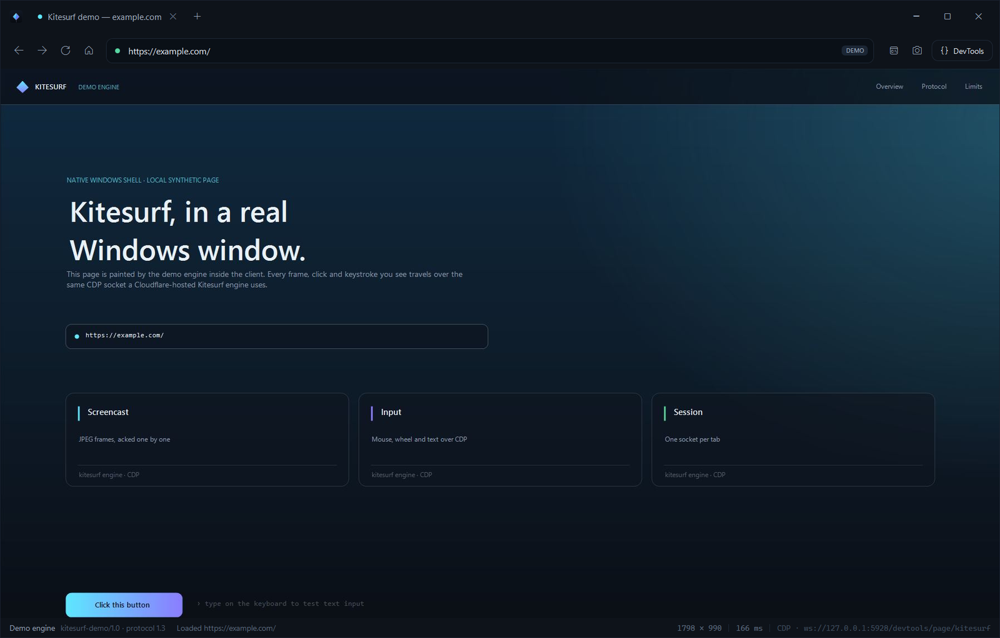
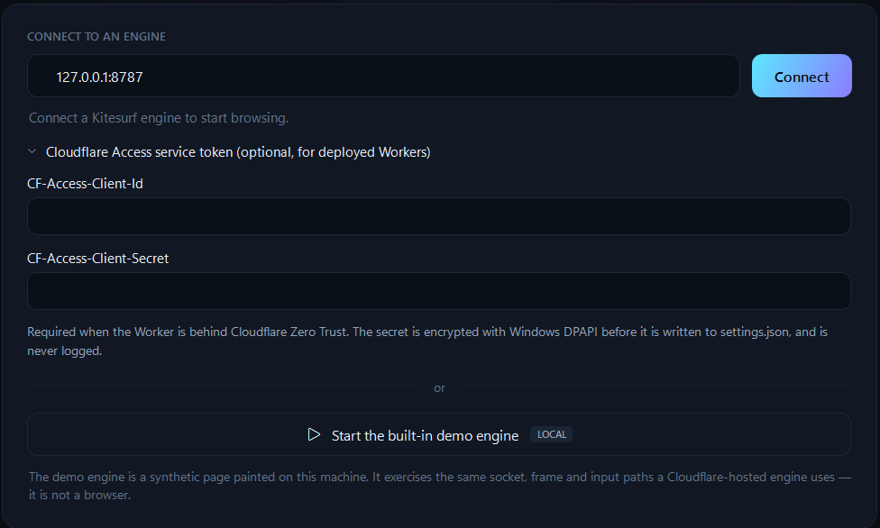

# Kitesurf Browser for Windows

A native, lightweight Windows desktop shell for the [Kitesurf](https://github.com/cloudflare/kitesurf) browser engine.

Kitesurf parses HTML, applies CSS, runs JavaScript via Boa, and renders frames inside Cloudflare Workers—all speaking the Chrome DevTools Protocol (CDP). **Kitesurf Browser for Windows** gives the engine the native desktop UI it has been missing: built with C# and WPF, with **zero Chromium and zero WebView2 underneath**.



---

## Quick Start (Try It in 10 Seconds)

No .NET SDK, Bazel, or Cloudflare account is required to test the client:

1. Download the latest self-contained `KitesurfBrowser.exe` from the [**Releases**](https://github.com/saboorsarem/kitesurf-windows/releases/latest) page.
2. Launch the built-in loopback demo engine to test rendering, tabs, and the console offline:
   ```cmd
   KitesurfBrowser.exe --demo
   ```

---

## Why This Exists

Kitesurf is built for lightweight, isolate-based browsing without heavy browser binaries. Existing ways to view Kitesurf output require either a headless terminal client (`kitesurf-cli`) or launching a full Google Chrome instance just to inspect a remote screencast.

This project provides a **dedicated native Windows client** that connects directly to local or remote Kitesurf engines over CDP WebSockets.

| Feature | How It Works |
| :--- | :--- |
| **Isolated Tabs** | Opens one dedicated CDP WebSocket per tab, so a stalled page never freezes the window or other tabs. |
| **Native DPI Screencast** | Streams `Page.startScreencast` frames, decodes images off the UI thread, and paces delivery with `sessionId` acknowledgments (`maxFramesInFlight = 2`). |
| **Exact Input Mapping** | Translates mouse clicks, scroll wheels, and keyboard events from WPF layout units directly into engine frame coordinates. |
| **Omnibox & History** | Smart URL normalization with search fallback, plus back/forward navigation powered by `Page.getNavigationHistory`. |
| **Live JS Console** | Streams `Runtime.consoleAPICalled` and `Runtime.exceptionThrown` events and supports interactive `Runtime.evaluate` execution. |
| **Engine Manager** | Probes `/json/version`, saves multiple local or remote Worker endpoints, auto-reconnects on launch, and surfaces clear connection diagnostics. |
| **Built-in Demo & Self-Test** | Ships with an embedded synthetic CDP engine (`--demo`) and an automated headless protocol verifier (`--selftest`). |
| **Auto-Reconnect** | A dropped socket walks 1s → 2s → 4s → 8s → 15s, keeps the tab's URL and history, and reports each attempt in the page overlay. |
| **Frame Telemetry** | The status bar shows resolution, frames per second and the ack-to-next-frame interval, measured per session. |
| **Raw CDP Inspector** | The `CDP` toggle in the console echoes every JSON-RPC request and event, which turns the client into a debugging tool for the engine itself. |
| **Clipboard Frames** | `Ctrl+Shift+S` copies the engine's `Page.captureScreenshot` render straight to the Windows clipboard. |
| **Zero-Fallback Architecture** | Renders strictly what Kitesurf's Blitz/Stylo/Boa pipeline produces—never falls back to WebView2 or embedded Chromium. |

---

## Connecting to a Kitesurf Engine

### Option A: Local Engine (`127.0.0.1:8787`)
1. Follow the upstream [Kitesurf build instructions](https://github.com/cloudflare/kitesurf) to start the local Worker:
   ```bash
   pnpm install --frozen-lockfile
   pnpm run dev
   ```
2. Open `KitesurfBrowser.exe` and connect to `127.0.0.1:8787`.

### Option B: Remote Cloudflare Worker
1. Deploy Kitesurf to your Cloudflare Workers Paid account (`pnpm run deploy`).
2. **Important:** Kitesurf has no built-in authentication. Always place **Cloudflare Access (Zero Trust)** in front of your `*.workers.dev` endpoint so public traffic cannot use your Worker CPU or outbound network.
3. Connect to your deployed Worker URL in the Engine Manager.

### Cloudflare Access Service Token

A Worker behind Zero Trust answers an unauthenticated `/json/version` with a redirect or a 403. Open
**Cloudflare Access service token (optional, for deployed Workers)** under the engine address, paste the
token's `CF-Access-Client-Id` and `CF-Access-Client-Secret`, and connect.

The client sends both headers on the discovery request *and* on the CDP WebSocket upgrade, because
Access checks each one. Create the token under Zero Trust → Access → Service Auth, and add a policy with
the **Service Auth** action that allows it. The secret is encrypted with Windows DPAPI (current user)
before it reaches `settings.json`, is masked in the UI, and never appears in `client.log`.



---

## CLI Flags & Local Storage

```cmd
KitesurfBrowser.exe                 # Launch normally and reconnect to saved engines
KitesurfBrowser.exe --demo          # Spin up the loopback synthetic engine and open a tab
KitesurfBrowser.exe --selftest      # Run headless CDP verification and write %TEMP%\kitesurf-selftest.json
```

Configuration and diagnostic logs are stored locally in `%APPDATA%\KitesurfBrowser`:
* `settings.json` — Saved engine endpoints, window bounds, and console drawer state.
* `client.log` — WebSocket connection and frame pacing diagnostics (no browsing content is logged).

---

## Keyboard Shortcuts

| Shortcut | Action |
| :--- | :--- |
| `Ctrl+T` / `Ctrl+W` | Open new tab / Close active tab |
| `Ctrl+L` | Focus the address bar |
| `Ctrl+R` or `F5` | Reload current page |
| ``Ctrl+` `` | Toggle the live JavaScript console drawer |
| `Ctrl+Tab` | Switch to next tab |
| `Ctrl+Shift+S` | Copy the current frame to the clipboard |
| `Alt+←` / `Alt+→` | Navigate back / forward |
| `F12` or `Ctrl+Shift+I` | Open the engine's DevTools inspector in your system browser |

---

## Architecture Overview

1. **Viewport-Locked Frames:** `Page.startScreencast` requests `surface size × DPI scale` so the engine rasterizes at crisp native resolution. Pointer coordinates are mapped back via `frame pixels ÷ surface layout units`.
2. **Backpressure-Aware Streaming:** Every `Page.screencastFrame` is acknowledged only after off-thread bitmap decoding completes, preventing frame queue buildup on high-latency Worker connections.
3. **Clean Separation of Concerns:**
   * `Core/Cdp/CdpClient.cs` — Async JSON-RPC over WebSocket transport.
   * `Core/PageSession.cs` — Per-tab CDP lifecycle, navigation, and screencast loop.
   * `Controls/PageSurface.cs` — High-DPI WPF rendering surface and input translator.
   * `DemoEngine/` — Self-contained loopback CDP server powering `--demo` and `--selftest`.

---

## Building from Source

Requires **Windows 10 (1809+) / Windows 11 (x64)** and the **.NET 8 SDK**.

```powershell
# Build Release binary
dotnet build -c Release

# Run automated headless protocol self-test
dotnet run -- --selftest

# Publish a self-contained single-file executable
dotnet publish -c Release -r win-x64 --self-contained true `
  -p:PublishSingleFile=true `
  -p:IncludeNativeLibrariesForSelfExtract=true `
  -p:EnableCompressionInSingleFile=true `
  -p:DebugType=none
```

The standalone executable outputs to `bin/Release/net8.0-windows/win-x64/publish/KitesurfBrowser.exe`.

---

## CI and Releases

`.github/workflows/windows-release.yml` builds the client on every push to `main` and on pull requests,
runs `--selftest` on the runner, and uploads the executable as a build artifact. Publishing a GitHub
Release attaches the compiled `KitesurfBrowser.exe` to that release automatically.

## Verifying a download

Every release attaches `SHA256SUMS.txt` next to the executable. From PowerShell, in the folder that
holds the download:

```powershell
cd $env:USERPROFILE\Downloads
$expected = (Get-Content .\SHA256SUMS.txt) -split '\s+' | Select-Object -First 1
(Get-FileHash .\KitesurfBrowser.exe -Algorithm SHA256).Hash -eq $expected
```

That prints `True` for an intact download. `Get-FileHash` resolves a relative path against the current
directory, so `Resolve-Path : Cannot find path 'C:\Users\<you>\KitesurfBrowser.exe'` means you are in
the wrong folder, not that the file is corrupt — `cd` into the download folder, or pass the full path.

---

## Current Limitations

Kitesurf is an experimental engine implementing a targeted subset of CDP:
* **Engine Fidelity:** Rendering, layout, and JS execution match Kitesurf's Blitz/Stylo/Boa stack without client-side shims.
* **Inspector Handoff:** Pressing `F12` opens Kitesurf's bundled DevTools frontend in your system browser (note that Google's hosted frontend restricts connections to `127.0.0.1`).
* **Demo Engine Scope:** `--demo` serves a static synthetic page to validate the client pipeline and is not a general web proxy.

---

## License

Licensed under the **Apache License 2.0**, matching the upstream [cloudflare/kitesurf](https://github.com/cloudflare/kitesurf) repository. See `LICENSE` for details.

The application icon is the upstream [Kitesurf logo](https://github.com/cloudflare/kitesurf/blob/main/.github/assets/kitesurf_logo.png). The Kitesurf name and logo are trademarks of Cloudflare, Inc., used here to identify the engine this client connects to; they are not covered by the Apache License. See `NOTICE`.
