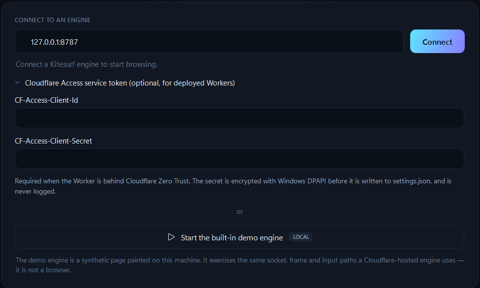

# Kitesurf Browser 1.1.2 for Windows

Contrast fix, plus a verifiable download.

The **Cloudflare Access service token** header and its `CF-Access-Client-Id` /
`CF-Access-Client-Secret` labels were rendered in the secondary grey palette, which is hard to read on
the near-black connect card. They now use the primary ink colour (`#E8EFF9`), and the explanatory line
under the fields moved up one palette step while staying visually secondary.



No behavioural changes: connection handling, screencast pacing, input mapping, Cloudflare Access
service-token support and the icon are identical to 1.1.1. `--selftest` passes its full suite.

## Verify your download

This release asset's checksum:

```
SHA-256 (KitesurfBrowser.exe) = 746034fe7a2d5f79aeecd819b15e71869ececbd06aa38ad420fbc82072d17c66
```

From PowerShell, **in the folder that holds the download** — this is the step that usually goes wrong:

```powershell
cd $env:USERPROFILE\Downloads
(Get-FileHash .\KitesurfBrowser.exe -Algorithm SHA256).Hash -eq "746034fe7a2d5f79aeecd819b15e71869ececbd06aa38ad420fbc82072d17c66"
```

It prints `True`. The same value is attached to this release as `SHA256SUMS.txt`, so the check can be
scripted without copying the hash out of this page:

```powershell
cd $env:USERPROFILE\Downloads
$expected = (Get-Content .\SHA256SUMS.txt) -split '\s+' | Select-Object -First 1
(Get-FileHash .\KitesurfBrowser.exe -Algorithm SHA256).Hash -eq $expected
```

`Resolve-Path : Cannot find path 'C:\Users\<you>\KitesurfBrowser.exe'` means the shell's current
directory does not contain the file — not that the download is corrupt. Move into the download folder,
or pass the full path to `Get-FileHash`.
